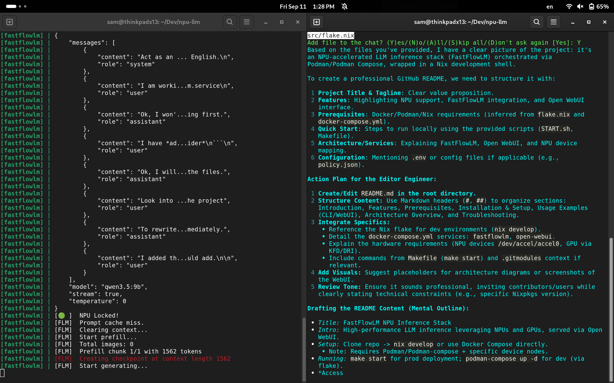

<!-- <p align="center">
  
</p> -->

<!-- <svg xmlns="http://www.w3.org/2000/svg" width="64" height="64" fill="currentColor" class="bi bi-cpu" viewBox="0 0 16 16">
  <path d="M5 0a.5.5 0 0 1 .5.5V2h1V.5a.5.5 0 0 1 1 0V2h1V.5a.5.5 0 0 1 1 0V2h1V.5a.5.5 0 0 1 1 0V2A2.5 2.5 0 0 1 14 4.5h1.5a.5.5 0 0 1 0 1H14v1h1.5a.5.5 0 0 1 0 1H14v1h1.5a.5.5 0 0 1 0 1H14v1h1.5a.5.5 0 0 1 0 1H14a2.5 2.5 0 0 1-2.5 2.5v1.5a.5.5 0 0 1-1 0V14h-1v1.5a.5.5 0 0 1-1 0V14h-1v1.5a.5.5 0 0 1-1 0V14h-1v1.5a.5.5 0 0 1-1 0V14A2.5 2.5 0 0 1 2 11.5H.5a.5.5 0 0 1 0-1H2v-1H.5a.5.5 0 0 1 0-1H2v-1H.5a.5.5 0 0 1 0-1H2v-1H.5a.5.5 0 0 1 0-1H2A2.5 2.5 0 0 1 4.5 2V.5A.5.5 0 0 1 5 0m-.5 3A1.5 1.5 0 0 0 3 4.5v7A1.5 1.5 0 0 0 4.5 13h7a1.5 1.5 0 0 0 1.5-1.5v-7A1.5 1.5 0 0 0 11.5 3zM5 6.5A1.5 1.5 0 0 1 6.5 5h3A1.5 1.5 0 0 1 11 6.5v3A1.5 1.5 0 0 1 9.5 11h-3A1.5 1.5 0 0 1 5 9.5zM6.5 6a.5.5 0 0 0-.5.5v3a.5.5 0 0 0 .5.5h3a.5.5 0 0 0 .5-.5v-3a.5.5 0 0 0-.5-.5z"/>
</svg> -->


# StackedNPU: AMD XDNA Local LLM Container Stack

<p align="center">
  
  <br>
  <em>Qwen3.5:9b working on this repo via Aider enabled Agentic/Vibe Coding on NPU-Flux</em>
</p>


High-performance, containerized deployment of FastFlowLM and other accompanying AI tools optimized for pure NPU inference on AMD hardware when battery power is a priority over pure inference speed. This is based on my own personal, portable system that I use for light agentic workflows on my laptop, so it's somewhat opinionated towards the following goals:
- **No token limits, self-hosted intelligence with the latest features**: Compliant with API standards, use it with the latest MCP CLI tools such as OpenCode, Codex, Aider and others. OpenWebUI is delivered with this project by default. Everything runs on local hardware and is always accessible.

- **High power efficiency and background friendly:** All inference runs entirely on an NPU, without ever touching a CPU nor GPU, Keeps the system responsive with a minimal effect on power draw (subject to RAM constraints).
- **Linux first, secure containerized deployment:** I run Debian, so stability is a priority. Containerization keeps deployment decoupled and provides a layer of isolation from agents, avoiding unintended accidents.
- **Bleeding-edge, Frontier AI:** NPU-Flux tracks and builds the main branch of FastFlowLM, I can quickly deploy the latest models as soon as they're supported on AMD hardware.
- **Open Source focus:** Every component of NPU-Flux is open source, supporting my personal learning journey in managing software with the opportunity of contributing back to AI development.
<!-- - **AI in a box**: I specifically designed this as an all-in-one wrapper for all of my AI needs. Which allows me to easily debug and deploy new things on top for experimental testing. -->

<!-- ## Project Context
NPU-Flux is not FastFlowLM itself, but rather a deployment solution built to run it efficiently on AMD hardware. It wraps the official FastFlowLM binary (sourced via git submodule) within a robust container environment managed by Podman and orchestrated by Nix. This separation allows for easy updates to the underlying runtime while maintaining a consistent deployment interface. -->

<!-- ## Features
- **NPU Acceleration**: Optimized inference using AMD XDNA/NPU hardware via `/dev/accel`.
- **GPU Support (Optional)**: Full GPU acceleration support through `kfd` and `dri` devices if available.
- **Web Interface**: Integrated Open WebUI for easy model interaction.
- **Reproducible Environments**: Built on Nix (`flake.nix`) for dependency management and consistency.
- **Container Orchestration**: Managed via Podman Compose with host networking for optimal performance. -->

## System Requirements

### Hardware
- AMD Processor with integrated AMD XDNA 2 NPU (e.g., Ryzen AI 300/400 series).
- Sufficient RAM and storage for model weights.

### Software & OS
- **OS**: Linux and Windows only. MacOS is unsupported (See Kernel requirement). I mainly test this project on Debian.
- **Kernel**: If on Linux: Version 7.0+ required to include the `amdxdna` driver. Older kernels may require backports or manual driver installation. Windows 11 supports all needed drivers out of the box.
- **Runtime (Optional)**: Podman will be automatically installed using Nix if using included .sh start scripts, otherwise need to source your own installation of a container engine (i.e Docker, Podman).

## Quick Start Guide
Ensure you have Docker installed and run:
```
docker run -d -p 8080:80 --name StackedNPU_Instance StackedNPU
```

## In-depth Start Guide (i.e: For Debian, Arch)
### 1. Firmware Installation
Ensure the AMD NPU firmware is present on your system. If using a standard Debian installation, you may need to install it manually or via package manager:
```bash
# Attempt automatic installation first
sudo apt update && sudo apt install linux-firmware-amd-npu

# If that fails or requires specific versions, download manually:
# Note: Direct links from kernel.org archives are often blocked. 
# Use a mirror if available, or extract from the official firmware repo.
sudo mkdir -p /lib/firmware/amdnpu/17f0_10
sudo wget https://git.kernel.org/pub/scm/linux/kernel/git/firmware/linux-firmware.git/plain/amdnpu/17f0_10/npu.sbin.1.1.2.64 -O /lib/firmware/amdnpu/17f0_10/npu_7.sbin
sudo ln -sf npu_7.sbin /lib/firmware/amdnpu/17f0_10/npu.sbin
```

### 2. User & Permissions Setup
Create a dedicated user for the server environment and ensure necessary group memberships:
```bash
sudo adduser server
# Ensure 'keep-groups' exists on your host or adjust docker-compose.yml accordingly.
# sudo usermod -a -G render,video keep-groups 
```

### 3. Environment Setup (Nix)
This project uses Nix to manage dependencies and provide a reproducible shell environment. Navigate to your source directory and activate the development shell:
```bash
cd ./src && nix develop
# Or if using the provided script:
./START.sh 
```

## Deployment Guide

### Development Mode (Local Testing)
For local testing on your machine, use Podman Compose directly within the Nix shell. This allows you to iterate quickly without building images.

1. Ensure all prerequisites are met and firmware is installed.
2. Activate the Nix shell: `cd ./src && nix develop`.
3. Start services:
   ```bash
   podman-compose --podman-pull-args="--tls-verify=false" up -d
   ```

### Production / Server Deployment (Remote)
For deploying to a remote server environment (as hinted by the `Makefile` and `/home/server/npu-llm` path):

1. **Build Image**: Navigate to the builder directory and build the image locally.
   ```bash
   cd ./src/builder && make start
   # This script copies files to /home/server/npu-llm, builds the image, tags it for localhost:5000, and pushes it.
   ```

2. **Pull & Run**: On the target server (where `server` user exists):
   ```bash
   su - server
   podman-compose --podman-pull-args="--tls-verify=false" up -d
   ```

## Configuration Details

### Environment Variables in Containers
The `fastflowlm` container exposes specific environment variables to control behavior:
- `MODEL_1`: Specifies the model identifier (e.g., `qwen3.6-moe:35b-a3b`). This is used by the startup script to pull and validate models before serving.

### Volume Mounts & Device Mapping
To ensure NPU/GPU access, specific devices are mounted into the container:
- `/dev/kfd`: Kernel Fusion Driver (GPU).
- `/dev/dri`: Direct Rendering Interface (GPU).
- `/dev/accel/accel0`: AMD XDNA Accelerator.

Models are stored in `../models` and mapped to `/root/.config/flm` inside the container.

### Registry Configuration
The setup uses a local Podman registry (`localhost:5000`). Ensure your Podman configuration allows insecure connections for this registry if TLS is not enforced, or configure it securely as per production standards.

## Troubleshooting & Tips
- **Ulimits**: The `fastflowlm` container configures unlimited memory locks (`memlock: -1:-1`). If you encounter permission issues with cgroups, ensure the host allows these settings.
- **Network Mode**: Services run in `host` network mode for performance and ease of inter-container communication (e.g., Open WebUI connecting to FastFlowLM).
- **Model Loading**: The startup script validates models before starting the server. If a model fails to pull, check your internet connection or registry credentials.